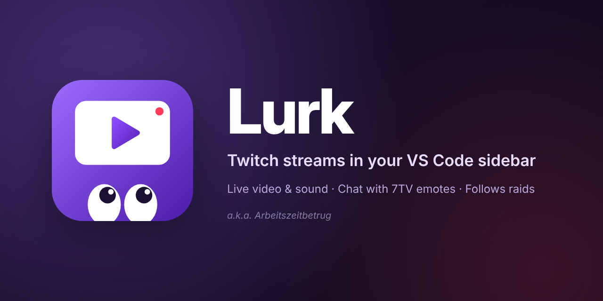
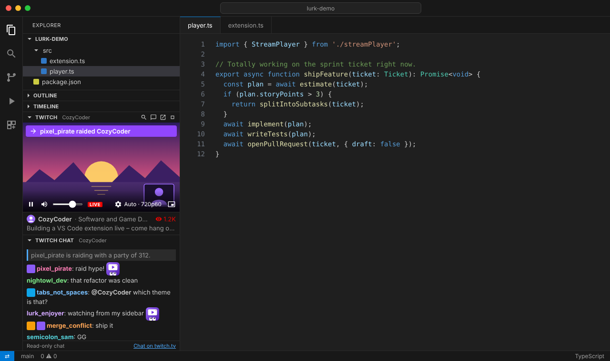

  

<a href="https://github.com/louis-mudrack/twitch-video-player-vsc-extension/blob/HEAD/README.md">English</a> · <b>Deutsch</b>

**Lurk** (a. k. a. _Arbeitszeitbetrug_) zeigt einen Twitch-Livestream in einem kleinen Panel im
Explorer von VS Code – direkt unter Gliederung und Zeitachse – und den Chat in einem zweiten Panel.
Wenn der Streamer jemanden raidet, wechselt Lurk automatisch zum nächsten Kanal.

  
   
  Illustration mit Platzhalterinhalten.

## Funktionen

- **Livestream in der Seitenleiste** – Kanalnamen eingeben oder twitch.tv-Link einfügen, und der
  Stream startet. Die Qualität passt sich der Panelgröße an; du kannst sie auch selbst wählen.
- **Folgt Raids** – raidet der Kanal jemanden, wechseln Player und Chat zum geraideten Kanal und
  zeigen an, wer wen geraidet hat. Lieber selbst entscheiden? Mit `twitchPlayer.followRaids: false`
  kommt stattdessen eine Benachrichtigung mit _Schauen_-Button.
- **Chat mit 7TV-Emotes** – Twitch-Emotes, globale und Kanal-Emotes von 7TV (inklusive
  Zero-Width-Overlays), Badges, Erwähnungen und Links, gut lesbare Namensfarben in jedem Theme.
  Nur lesend.
- **Läuft im Hintergrund weiter** – Panel zuklappen, zu Suche oder Quellcodeverwaltung wechseln
  oder VS Code minimieren: Der Ton läuft weiter.
- **Bild im Bild** – Doppelklick aufs Video öffnet ein schwebendes Fenster.
- **Nah am Live-Geschehen** – nur wenige Sekunden Verzögerung, damit Bild und Chat zusammenpassen.
- **Offline-Kanäle** – starten von selbst, sobald der Kanal live geht.
- **Mehrsprachig** – Deutsch und Englisch, passend zur Anzeigesprache von VS Code.

## Installation

- **Visual Studio Marketplace / Open VSX:** in der Erweiterungsansicht nach „Lurk“ suchen, sobald
  die Erweiterung dort veröffentlicht ist.
- **Aus einem Release:** die `.vsix` von der
  [Release-Seite](https://github.com/louis-mudrack/twitch-video-player-vsc-extension/releases)
  herunterladen und in VS Code **Erweiterungen: Aus VSIX installieren…** ausführen.

Benötigt VS Code 1.95 oder neuer.

## Benutzung

1. Explorer öffnen und das Panel **Twitch** aufklappen – oder in der Befehlspalette
   **Lurk: Twitch-Kanal öffnen…** ausführen.
2. Kanalnamen eingeben, z. B. `papaplatte`, und <kbd>Enter</kbd> drücken.
3. **Einmal in den Player klicken**, um den Ton einzuschalten. VS Code erlaubt Ton erst nach einem
   Klick in das Panel; bis dahin zeigt der Player einen Hinweis.
4. **Twitch-Chat** aufklappen. Beide Panels lassen sich frei verschieben: über- oder untereinander,
   in das untere Panel oder in die sekundäre Seitenleiste.

In der Titelleiste des Panels gibt es Buttons, um einen anderen Kanal zu öffnen, den Chat zu
zeigen, den Stream auf twitch.tv zu öffnen und ihn zu beenden. Zuletzt geschaute Kanäle stehen auf
dem Startbildschirm.

## Einstellungen

| Einstellung                      | Standard | Beschreibung                                                          |
| -------------------------------- | -------- | --------------------------------------------------------------------- |
| `twitchPlayer.followRaids`       | `true`   | Automatisch zum geraideten Kanal wechseln.                            |
| `twitchPlayer.quality`           | `auto`   | Bevorzugte Qualität: `auto`, `1080p`, `720p`, `480p`, `360p`, `160p`. |
| `twitchPlayer.resumeLastChannel` | `false`  | Den letzten Kanal beim Start von VS Code wieder öffnen.               |
| `twitchPlayer.chat.maxMessages`  | `200`    | Anzahl der Chatnachrichten, die im Chat-Panel bleiben.                |

## Gut zu wissen

- **Kein Konto, kein Tracking.** Lurk meldet sich nicht bei Twitch an und sammelt keine Daten. Es
  verbindet sich nur mit Twitch (`gql.twitch.tv`, `usher.ttvnw.net` und dem Video-CDN,
  `hermes.twitch.tv` für Raids, `irc-ws.chat.twitch.tv` für den Chat, `static-cdn.jtvnw.net` für
  Emotes und Badges) und mit 7TV (`7tv.io`, `cdn.7tv.app`).
- **Inoffizielle Schnittstellen.** Lurk nutzt dieselben öffentlichen Schnittstellen ohne Anmeldung
  wie die Website twitch.tv, so wie andere Drittanbieter-Player auch. Sie sind keine offizielle API;
  Twitch kann sie jederzeit ändern, und dann funktioniert etwas eventuell erst nach einem Update
  wieder.
- **Werbung** läuft wie auf twitch.tv; währenddessen zeigt der Player „Werbepause“ an.
- **Der Chat ist nur lesend.** Zum Schreiben den Link _Auf twitch.tv chatten_ nutzen.

## Mitmachen

Fehlerberichte, Ideen, Übersetzungen und Pull Requests sind willkommen – siehe
[CONTRIBUTING.md](CONTRIBUTING.md). Für eine neue Sprache braucht es nur zwei JSON-Dateien.

## Lizenz

Lurk ist freie Software unter der [GNU General Public License v3.0 oder später](LICENSE). Der
mitgelieferte AAC-Decoder basiert auf FAAD2, das unter der GPL steht; deshalb steht die Erweiterung
insgesamt unter der GPL. Komponenten von Dritten sind in
[THIRD_PARTY_NOTICES.md](THIRD_PARTY_NOTICES.md) aufgeführt.

Lurk steht in keiner Verbindung zu Twitch Interactive, Inc. oder 7TV und wird von ihnen weder
unterstützt noch gesponsert. Twitch ist eine Marke von Twitch Interactive, Inc.
